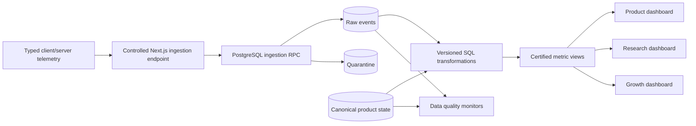

# A L T E R . — LR-001 Analytics Specification

**Document ID:** DATA-AN-LR-001  
**Work package:** WP-004 Data Foundation  
**Status:** Implementation-ready  
**Last updated:** 2026-07-19

---

## 1. Objective

Provide reproducible metrics that answer whether users voluntarily explore, inspect, save, combine, and return. Metrics are directional until traffic quality, sample size, and observation-window maturity are known.

## 2. Analytics architecture



Layers:

1. typed telemetry producer;
2. trusted server ingestion and context enrichment;
3. append-only raw events;
4. relational canonical state;
5. versioned SQL transformations;
6. certified views consumed by dashboards and decision snapshots.

No external warehouse is required for LR-001.

## 3. Eligibility rules

Exclude from certified metrics:

- `environment != 'production'`;
- test/internal identities and sessions;
- automated QA traffic;
- shared-preview namespaces;
- sessions with no valid `session_started`;
- quarantined/invalid events;
- sessions affected by a declared blocker, unless shown separately.

A first eligible session begins when a production participant starts a valid non-test session.

## 4. Metric dictionary

### 4.1 Onboarding completion rate

- Numerator: unique eligible identities with persisted `onboarding_completed`.
- Denominator: unique eligible identities with `onboarding_viewed`.
- Window: first eligible session.
- Breakouts: onboarding version, traffic source, platform.

`completed identities / onboarding viewers`

### 4.2 Skip rate

- Numerator: unique eligible identities with persisted `onboarding_skipped`.
- Denominator: unique eligible identities with `onboarding_viewed`.

Completion and skip are mutually exclusive in canonical state.

### 4.3 Feed depth

Per eligible session:

`max(product_impression.properties.feed_position)`

Report median, p25, p75, p90 and percentages reaching 5/10/20/30/50, split by first/return session.

### 4.4 Product impressions

Count valid de-duplicated `product_impression` events. Also report unique `(identity, product_id)` exposures and number of unique products exposed.

### 4.5 Product-detail rate

Primary:

`unique (session_id, product_id) feed-origin detail opens / unique (session_id, product_id) qualified impressions`

A detail open without an earlier same-session qualified impression is classified as non-feed-origin and excluded from the primary denominator.

Secondary:

`sessions with ≥1 detail open / sessions with ≥1 qualified impression`

### 4.6 Save rate

Product-level:

`unique (identity, product_id) successful saves / unique (identity, product_id) qualified impressions`

User-level:

`eligible identities with ≥1 successful save / eligible identities with ≥1 qualified impression`

Report removals and net active saves separately.

### 4.7 Wardrobe revisit rate

Eligible population: return-session identities with at least one active saved product at session start.

`eligible identities with wardrobe_viewed / eligible return identities with active save`

### 4.8 Challenge exposure and eligibility

Report challenge viewers by:

- state at view;
- count of eligible saved products;
- whether every required slot has at least one eligible product;
- challenge version.

### 4.9 Challenge start rate

Primary:

`unique identities with challenge_started / unique identities with challenge_viewed in not_started state`

Constrained:

`starters with sufficient eligible saved items / viewers with sufficient eligible saved items`

### 4.10 Challenge completion rate

`unique challenge_progress records completed / unique challenge_progress records started`

Report:

- median time to completion;
- same-session vs return-session completion;
- abandonment by last filled-slot count;
- invalidation rate;
- discovery redirect rate.

### 4.11 Return rate

Primary D7:

`first-session identities with ≥1 later eligible session within 7×24h / first-session identities with complete 7-day observation`

Secondary: D1 and D3 using 24h and 72h.

Do not include immature cohorts in denominators.

### 4.12 Session duration

`min(last_valid_event_at - session.started_at, 4 hours)`

Report median and p75. Single-event sessions have duration `0` and are reported separately.

### 4.13 Session frequency

For identities with complete 7-day observation:

`count(eligible sessions in first 7 days)`

Report mean, median, and distribution `1`, `2`, `3`, `4+`.

### 4.14 Continuation cue selection

`identities selecting continuation action / identities with a qualified continuation cue view`

Break out by cue type and target surface. This is navigation utility, not retention itself.

## 5. Supporting health metrics

- onboarding persistence failure rate;
- feed batch failure rate;
- Product Detail failure rate;
- save/remove rejection and technical failure rates;
- active saves per identity;
- save-to-remove ratio;
- challenge operation failure rate;
- state restoration failure rate;
- event ingestion latency p50/p95;
- duplicate attempted delivery rate;
- schema rejection/quarantine rate;
- session recovery rate;
- impression-bearing Discover session rate.

## 6. Canonical user state

Relational product state, not event replay alone, defines current truth:

```text
identity
├── onboarding state + versions + preferences
├── active Wardrobe
│   └── active saved products
├── active Challenge progress
│   ├── challenge version
│   ├── state
│   └── active slot selections
├── immutable Challenge completion
├── last meaningful destination
└── state revision
```

Events explain transitions and support sequence analysis; state tables determine the current UI state.

## 7. Session reconstruction

1. Order events by `occurred_at`, then `client_sequence`, then `received_at`.
2. Validate referenced identity/session ownership.
3. If a valid event references an unknown session, create a derived recovered session.
4. Split recovered sessions where inactivity exceeds 30 minutes.
5. Mark recovery status; never rewrite original event payload.
6. Exclude irrecoverable records from certified session metrics and report their volume.

## 8. Identity and return classification

`is_return_session = session_number > 1`

The earliest eligible session for a unified identity is the first session. Account upgrade/merge must not reset anonymous history.

D1/D3/D7 cuts are analysis windows, not different session definitions.

## 9. Interpretation constraints

- Feed depth indicates exposure, not preference strength.
- Detail opens indicate inspection, not purchase intent.
- Saves indicate explicit collection, not ownership or willingness to pay.
- Challenge completion indicates task completion, not styling quality.
- Return indicates renewed use, not long-term retention.
- Session duration alone is not engagement quality.
- Small samples require raw counts and uncertainty intervals.
- Traffic source and cohort composition must accompany comparisons.
- Quantitative behavior and qualitative interpretation remain separate.
- LR-001 cannot support predictive, enterprise, or market-wide claims.

## 10. Certified views

Required versioned views:

- `analytics.eligible_sessions_v1`
- `analytics.qualified_product_impressions_v1`
- `analytics.session_feed_depth_v1`
- `analytics.product_detail_rate_v1`
- `analytics.save_rate_v1`
- `analytics.wardrobe_revisit_v1`
- `analytics.challenge_eligibility_v1`
- `analytics.challenge_funnel_v1`
- `analytics.return_rate_v1`
- `analytics.session_metrics_v1`
- `analytics.continuation_metrics_v1`
- `analytics.data_quality_daily_v1`

Dashboards use certified views, not ad hoc raw-event logic. Each view records definition version, deployment version compatibility, and refresh timestamp.

## 11. Core sequence outputs

For each eligible identity, construct an ordered LR-001 sequence using event and canonical state references:

`session_started → onboarding terminal state → discover_viewed → impressions → detail opens → saves/removals → wardrobe views → challenge transitions → completion → later session`

Sequence tables must expose missing expected events, late arrivals, and state/event mismatches without imputing user intent.

## 12. Experiment readiness

LR-001 ships one baseline experience. Future experiment support requires:

- immutable `experiment_id`, `variant_id`, `assignment_id`;
- deterministic assignment by stable identity;
- assignment before exposure;
- separate exposure event;
- no silent cross-over;
- intention-to-treat analysis;
- approved hypothesis, primary metric, guardrails, sample plan, and stop rule.

No experiment is active in LR-001.

## 13. Analysis cadence

- ingestion and critical QA: every 5–15 minutes;
- Product dashboard: hourly;
- Research dashboard: daily;
- Growth/source-quality dashboard: daily;
- formal decision analysis: frozen snapshot with query/view version and extraction timestamp;
- D7 metrics: only after cohort maturity.

## 14. Decision report requirements

Every HQ decision report includes:

- exact cohort dates and traffic sources;
- eligible counts and excluded counts;
- metric definitions/view versions;
- observation-window maturity;
- distribution and raw numerator/denominator;
- known incidents and measurement limitations;
- qualitative evidence kept separate;
- explicit distinction between observation, interpretation, and decision.
