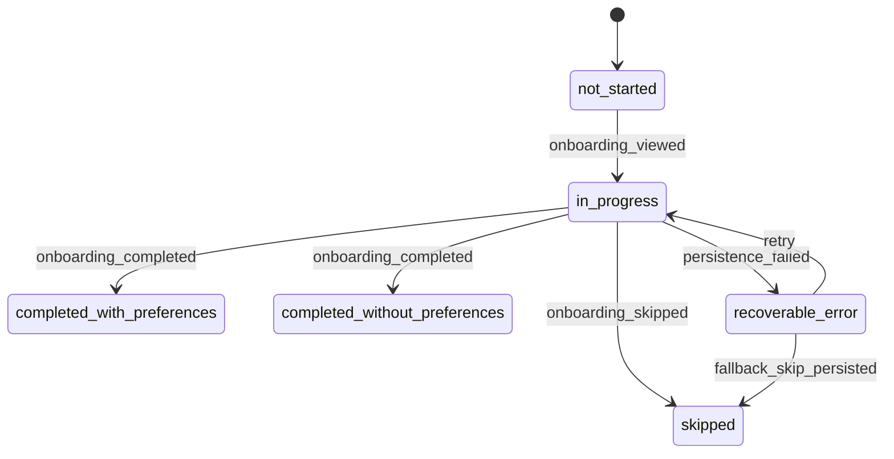
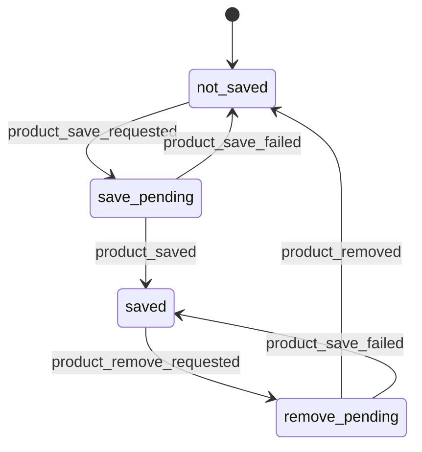
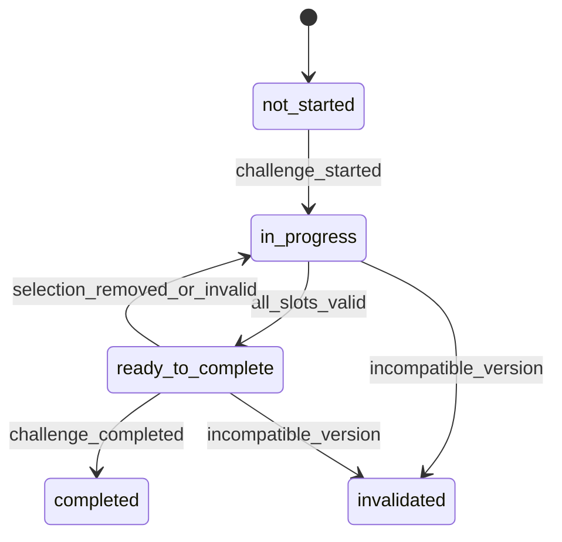

# A L T E R . — LR-001 Event Specification

**Document ID:** DATA-EVENT-LR-001  
**Work package:** WP-004 Data Foundation  
**Status:** Implementation-ready  
**Owner:** Data & Analytics  
**Release:** Learning Release 001  
**Schema version:** 1.0.0  
**Last updated:** 2026-07-19

---

## 1. Purpose

Define the canonical behavioral event contract for LR-001. Events represent observable user actions or measurable system outcomes, support deterministic reconstruction of the minimum valid journey, and exclude sensitive personal data.

Instrumented journey:

`Open → Onboard/Skip → Browse → Open detail → Save → View Wardrobe → Start Challenge → Select items → Complete Challenge → Exit → Return → Resume`

This document is authoritative for implementation event names. Where the Product PRD uses a broader or earlier event name, this specification takes precedence.

## 2. Naming convention

Canonical event names use:

`<domain>_<object>_<past_tense_action>`

Rules:

- lowercase `snake_case`;
- one event expresses one completed observation;
- use past tense: `product_saved`, not `save_product`;
- use `viewed` for a surface becoming visible;
- use `opened` for explicit navigation into an object;
- use `selected` for user choice;
- use `requested` for intent before a state-changing operation;
- use `completed`, `saved`, `removed`, or `started` only after canonical persistence succeeds;
- use `failed` for a failed system operation;
- do not encode versions, platforms, variants, or IDs in event names;
- never rename an event in place; add a new event version or replacement event.

## 3. Event envelope

Every accepted event MUST contain:

| Property | Type | Required | Definition |
|---|---:|---:|---|
| `event_id` | UUID | yes | Globally unique idempotency key generated before enqueueing. |
| `event_name` | text | yes | Canonical event name. |
| `event_version` | integer | yes | Event contract version, beginning at `1`. |
| `occurred_at` | timestamptz | yes | UTC time of observation on the producer. |
| `received_at` | timestamptz | server | UTC ingestion time generated by server. |
| `anonymous_user_id` | UUID | server/context | Stable analytical anonymous identity resolved from authenticated context. |
| `user_id` | UUID/null | no | Upgraded account identity when available. |
| `session_id` | UUID | yes | Current analytics session. |
| `release_id` | text | yes | `LR-001`. |
| `app_version` | text | yes | Deploy/build identifier. |
| `platform` | enum | yes | `web_mobile`, `web_desktop`, `ios`, `android`. |
| `environment` | enum | server | `local`, `preview`, `staging`, `production`. |
| `surface` | enum | yes | Surface where observation occurred. |
| `source_surface` | enum/null | no | Surface that led to the action. |
| `properties` | jsonb | yes | Event-specific allow-listed payload. |
| `context` | jsonb | yes | Technical context below. |

Identity, environment, internal/test status, and `received_at` must be derived or overwritten by trusted server code. Client-supplied owner identity is never authoritative.

### 3.1 Context properties

| Property | Type | Required | Notes |
|---|---:|---:|---|
| `timezone_offset_minutes` | integer | yes | Device offset at occurrence. |
| `locale` | text | yes | BCP-47 locale. |
| `viewport_width` | integer | web | CSS pixels. |
| `viewport_height` | integer | web | CSS pixels. |
| `network_state` | enum/null | no | `online`, `offline`, `unknown`. |
| `traffic_source` | text/null | no | Controlled source, never arbitrary free text. |
| `cohort_id` | text/null | no | Approved recruitment/research cohort. |
| `experiment_assignments` | object | yes | Empty object for LR-001 baseline. |
| `client_sequence` | integer | yes | Monotonic sequence for the current installation/auth identity. |
| `preview_namespace` | text/null | server | Shared-preview isolation namespace. |

## 4. Canonical enumerations

### 4.1 Surfaces

`app_boot`, `onboarding`, `discover`, `product_detail`, `wardrobe`, `challenge`, `challenge_picker`, `continuation`, `error_recovery`

### 4.2 Product source surfaces

`discover`, `product_detail`, `wardrobe`, `challenge`, `challenge_picker`

### 4.3 Error classes

`network`, `timeout`, `validation`, `not_found`, `permission`, `conflict`, `persistence`, `schema`, `identity`, `unknown`

### 4.4 Onboarding states

`not_started`, `in_progress`, `completed_with_preferences`, `completed_without_preferences`, `skipped`, `recoverable_error`

### 4.5 Challenge states

`not_started`, `in_progress`, `ready_to_complete`, `completed`, `invalidated`

## 5. Session model

A session begins when:

- the application becomes active and no prior session exists;
- the prior eligible activity occurred more than **30 minutes** earlier; or
- a prior session was explicitly closed and the application is reopened.

A session ends analytically after 30 minutes of inactivity. `session_ended` may be emitted operationally but is not authoritative.

A session is a return session when the unified identity has at least one earlier eligible session and the new session begins after the 30-minute boundary.

Primary LR-001 return window: **7 × 24 hours after first eligible session start**. Secondary windows: D1 and D3.

Exclude internal QA, automated tests, preview, staging, and identities/sessions marked test from certified metrics.

## 6. Qualified product impression

Emit `product_impression` once per `(session_id, feed_instance_id, product_id)` only when:

1. the card is rendered;
2. at least **50%** of card area is visible;
3. visibility remains continuous for **1,000 ms**;
4. document/app is foregrounded;
5. no qualified impression was already emitted for the same product in that feed instance/session.

Fetched, prefetched, mounted outside the viewport, partially visible below threshold, or background-tab cards do not qualify.

Required properties:

- `product_id`
- `product_category`
- `feed_instance_id`
- `feed_position` (1-based absolute position)
- `feed_order_version`
- `visible_ratio`
- `visible_duration_ms`
- `batch_number`
- `is_saved_at_impression`

## 7. Feed depth

Session feed depth is the maximum `feed_position` among qualified impressions in Discover.

`feed_depth_reached` is emitted once when a new threshold is first crossed in a session:

`5, 10, 20, 30, 50, 75, 100`

Required properties:

- `feed_instance_id`
- `depth_threshold`
- `max_qualified_position`
- `feed_order_version`

The certified metric is derived from qualified impressions; threshold events are operational convenience only.

## 8. Event taxonomy

### 8.1 Session, state restoration, and continuation

| Event | Trigger | Required properties |
|---|---|---|
| `session_started` | New analytics session persists. | `session_number`, `is_return_session`, `prior_session_ended_at`, `entry_route` |
| `app_state_restored` | Canonical persisted state loads successfully. | `restore_result`, `restored_entities`, `state_revision` |
| `app_state_restore_failed` | Persisted state cannot be loaded or validated. | `error_class`, `error_code`, `fallback_applied` |
| `continuation_cue_viewed` | Eligible continuation card qualifies as visible. | `cue_type`, `target_surface`, `challenge_progress_count` |
| `continuation_action_selected` | User selects the cue. | `cue_type`, `target_surface` |
| `continuation_cue_dismissed` | User dismisses cue. | `cue_type`, `persistence_scope` |

### 8.2 Onboarding

| Event | Trigger | Required properties |
|---|---|---|
| `onboarding_viewed` | First onboarding screen qualifies as viewed. | `onboarding_version`, `step_id`, `step_index`, `total_steps` |
| `onboarding_step_viewed` | A later step qualifies as viewed. | `onboarding_version`, `step_id`, `step_index` |
| `onboarding_preference_selected` | Preference changes unselected→selected. | `onboarding_version`, `preference_id`, `preference_set_version` |
| `onboarding_preference_removed` | Preference changes selected→unselected. | same as above |
| `onboarding_completed` | Completion persists. | `onboarding_version`, `selected_preference_ids`, `preference_count`, `completion_type`, `operation_id` |
| `onboarding_skipped` | Skip persists. | `onboarding_version`, `step_id`, `selected_preference_count_before_skip`, `operation_id` |
| `onboarding_persistence_failed` | Completion/skip is rejected or fails. | `attempted_action`, `operation_id`, `error_class`, `error_code`, `retryable` |

### 8.3 Discover and feed

| Event | Trigger | Required properties |
|---|---|---|
| `discover_viewed` | Discover qualifies as viewed. | `feed_instance_id`, `feed_order_version`, `entry_reason` |
| `feed_batch_requested` | Client requests a batch. | `feed_instance_id`, `batch_number`, `cursor_hash`, `requested_count` |
| `feed_batch_loaded` | Valid batch is delivered. | `feed_instance_id`, `batch_number`, `returned_count`, `latency_ms`, `is_terminal` |
| `feed_batch_failed` | Batch request fails. | `feed_instance_id`, `batch_number`, `error_class`, `error_code`, `retryable` |
| `product_impression` | Qualified-impression definition is met. | Section 6 properties |
| `feed_depth_reached` | New threshold is crossed. | Section 7 properties |
| `feed_exhausted` | Valid terminal state is reached. | `feed_instance_id`, `max_qualified_position` |

### 8.4 Product detail

| Event | Trigger | Required properties |
|---|---|---|
| `product_detail_opened` | Detail becomes visible after explicit navigation. | `product_id`, `product_category`, `source_surface`, `source_feed_position`, `is_saved` |
| `product_detail_closed` | User exits detail. | `product_id`, `close_method`, `dwell_ms`, `resulting_saved_state` |
| `product_detail_failed` | Product is unavailable or detail fails. | `product_id`, `error_class`, `error_code`, `recovery_route` |

### 8.5 Save and Wardrobe

| Event | Trigger | Required properties |
|---|---|---|
| `product_save_requested` | User initiates save. | `product_id`, `source_surface`, `prior_saved_state`, `operation_id` |
| `product_saved` | Canonical save persists. | `product_id`, `product_category`, `source_surface`, `operation_id`, `saved_product_id` |
| `product_remove_requested` | User initiates removal. | `product_id`, `source_surface`, `prior_saved_state`, `operation_id`, `challenge_impact` |
| `product_removed` | Canonical removal persists. | `product_id`, `source_surface`, `operation_id`, `challenge_resolution` |
| `product_save_failed` | Save or removal is rejected/fails. | `product_id`, `attempted_action`, `operation_id`, `error_class`, `error_code`, `retryable` |
| `wardrobe_viewed` | Wardrobe qualifies as viewed. | `saved_product_count`, `entry_reason`, `is_return_session` |
| `wardrobe_empty_viewed` | Empty Wardrobe qualifies as viewed. | `entry_reason` |

### 8.6 Challenge

| Event | Trigger | Required properties |
|---|---|---|
| `challenge_viewed` | Challenge qualifies as viewed. | `challenge_id`, `challenge_version`, `challenge_state`, `filled_slot_count`, `required_slot_count` |
| `challenge_started` | State persists `not_started→in_progress`. | `challenge_id`, `challenge_version`, `eligible_saved_count`, `required_slot_count`, `operation_id` |
| `challenge_slot_opened` | Slot picker opens. | `challenge_id`, `slot_id`, `eligible_item_count`, `slot_state` |
| `challenge_item_selected` | Selection persists. | `challenge_id`, `slot_id`, `product_id`, `operation_id`, `replaced_product_id` |
| `challenge_item_removed` | Removal persists. | `challenge_id`, `slot_id`, `product_id`, `operation_id`, `removal_reason` |
| `challenge_discovery_redirected` | User routes to Discover for a slot. | `challenge_id`, `slot_id`, `required_category` |
| `challenge_completion_attempted` | User explicitly attempts completion. | `challenge_id`, `valid_slot_count`, `required_slot_count`, `is_valid` |
| `challenge_completed` | Immutable completion persists. | `challenge_id`, `challenge_version`, `completion_id`, `selected_product_ids_by_slot`, `duration_since_start_ms`, `operation_id` |
| `challenge_state_invalidated` | Prior progress becomes incompatible. | `challenge_id`, `prior_version`, `current_version`, `reason`, `resolution` |
| `challenge_operation_failed` | Challenge mutation is rejected/fails. | `challenge_id`, `attempted_action`, `operation_id`, `error_class`, `error_code`, `retryable` |

## 9. Product interaction model

Every product interaction is linked through:

- canonical `product_id`;
- current `session_id`;
- `source_surface`;
- `feed_instance_id` and `feed_position` when originating in Discover;
- one immutable `operation_id` for each state-changing action.

Detail opens may repeat. Qualified impressions de-duplicate per session/feed/product. Save success does not repeat while the product is already actively saved.

## 10. State transitions

### 10.1 Onboarding

### 10.2 Saved product

### 10.3 Challenge

## 11. Event versioning

- Event payloads use integer `event_version`.
- Backward-compatible optional additions do not increment the version.
- Removing/renaming a property, changing type/semantics, or changing requiredness increments the version.
- Producers may dual-emit during migration for no longer than seven days when approved.
- Consumers declare supported versions.
- Unknown future versions remain stored/quarantined but are excluded from certified metrics until mapped.
- Contracts require fixtures and pull-request review.

## 12. Delivery, retries, and idempotency

- Generate `event_id` before local enqueue.
- Preserve `event_id`, `occurred_at`, and `client_sequence` through retries/offline delivery.
- Batch maximum: 100 events.
- Payload maximum: 16 KB per event.
- Ingestion order is mandatory:

`identity ensure → session ensure/upsert → contract validation → idempotent insert`

- Duplicate `event_id` returns accepted/duplicate without writing a second event.
- State-changing success events are produced in the same canonical transaction as state persistence where defined by Engineering.
- Expected domain rejections may produce structured failure events; unexpected transaction failures are reported through server observability because the transaction rolls back.

## 13. Privacy restrictions

Payloads MUST NOT include:

- name, email, phone, postal address;
- precise location;
- body measurements;
- protected traits;
- payment, purchase, or financial information;
- contact lists;
- arbitrary free text;
- raw URLs with query strings;
- image pixels or biometric identifiers;
- advertising IDs;
- secrets, tokens, cookies, or authorization headers.

Allowed identity fields are random product-continuity UUIDs resolved from authenticated server context.

## 14. Implementation checklist

- [ ] Contract and TypeScript schema share one source.
- [ ] Client creates immutable event IDs before enqueue.
- [ ] Server overwrites trusted context fields.
- [ ] Session ensure is idempotent.
- [ ] Events validate by `event_name + event_version`.
- [ ] Invalid payloads enter quarantine without certified-metric inclusion.
- [ ] Product and challenge IDs are validated where required.
- [ ] No success event precedes persistence.
- [ ] Preview/test traffic is separable.
- [ ] Two-user ownership tests pass.
- [ ] Offline replay preserves occurrence ordering.
- [ ] Data QA fixtures cover every critical event.
