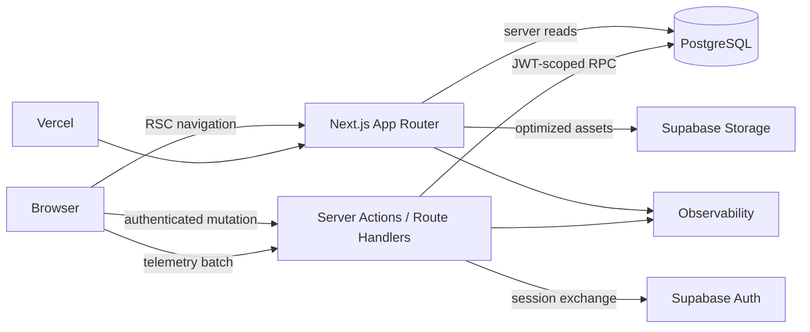

# A L T E R . — LR-001 System Architecture

**Document ID:** ENG-SYS-LR-001  
**Work package:** WP-005 Engineering Foundation  
**Status:** Implementation-ready  
**Canonical stack:** Next.js, React, TypeScript, Tailwind CSS, Supabase, PostgreSQL

## 1. Canonical architecture

LR-001 is a single Next.js application deployed to Vercel, backed by one Supabase project per persistent environment. PostgreSQL is the source of truth for identity-linked product state. Browser state is used only for resumable UI context, offline telemetry, and pending mutation intent.

## 2. Boundaries

### Browser
Owns transient interaction state, scroll position, pending optimistic state, IntersectionObserver timers, IndexedDB telemetry queue, and Supabase browser session persistence. It never decides authorization identity or writes directly to protected tables.

### Next.js server
Owns initial route resolution, continuation decision, mutation orchestration, payload validation, rate limiting, server-generated events, and secure environment access. Server Components perform read-only data loading. State changes use Server Actions calling security-definer PostgreSQL RPCs.

### Supabase
- **Auth:** anonymous sign-in and future account linking.
- **PostgreSQL:** canonical state, event store, sessions, feed instances, RLS, transactional RPCs.
- **Storage:** curated product and onboarding imagery when not served from approved remote origins.
- **Realtime:** not used in LR-001.
- **Edge Functions:** not canonical; reserved only if Vercel-to-Supabase latency or platform limits later justify migration.

## 3. Data and mutation flow

1. Browser restores Supabase Auth session.
2. Missing session triggers `signInAnonymously`.
3. Server verifies JWT and resolves `auth.uid()`.
4. Server Component reads public catalog plus owner-scoped state.
5. Client submits a mutation with a UUID `operation_id`.
6. Server Action validates input and calls one RPC with the user JWT.
7. RPC authorizes, mutates, and emits the canonical success event in one transaction.
8. Canonical state is returned; client commits or rolls back optimistic UI.

No state-changing success event may be emitted before persistence commits.

## 4. Telemetry flow

Client observations are queued in IndexedDB and sent to `POST /api/events`. The endpoint validates the envelope and event-specific contract, derives identity from the JWT, ensures the analytics session, then calls `ingest_events`. Invalid payloads are quarantined. Duplicate `event_id` values are no-ops.

Required order:

`identity ensure → session ensure/upsert → schema validation → idempotent insert`

## 5. Image and asset strategy

- Use `next/image` with explicit dimensions or aspect ratio.
- Curated local/editorial assets use Supabase Storage or repository static assets.
- Remote product domains are allow-listed.
- Generate responsive AVIF/WebP variants through the deployment image optimizer.
- Product cards reserve layout space before image load.
- Broken images fall back to the approved image-error state.
- Original source URLs are never accepted from arbitrary client input.

## 6. Environment topology

| Environment | App | Supabase | Data |
|---|---|---|---|
| local | Next.js dev | local CLI stack | deterministic seed |
| test | CI process | ephemeral local stack | test fixtures |
| preview | Vercel preview | shared preview project | synthetic only |
| staging | protected Vercel deployment | dedicated staging project | release-like synthetic/QA |
| production | Vercel production | dedicated production project | real LR-001 data |

Production and staging never share databases, Auth users, storage buckets, or secrets.

## 7. Failure boundaries

- Telemetry failure does not block safe browsing or successful product-state mutations.
- Mutation failure never appears as success; optimistic state is rolled back.
- Route-level errors are isolated by App Router error boundaries.
- Product image failure is isolated to the image component.
- Feed pagination failure preserves already loaded products.
- Corrupt local UI state is discarded; canonical server state is reloaded.
- Identity loss creates a new anonymous identity and clearly explains that prior local state cannot be recovered.
- Service-role compromise is treated as a production security incident.

## 8. Performance budgets

- Mobile LCP: p75 ≤ 2.5 s on mid-range 4G.
- INP: p75 ≤ 200 ms.
- CLS: p75 ≤ 0.10.
- Initial route JS: ≤ 180 KB gzip, excluding framework shared chunks.
- Product-state mutation acknowledgement: p95 ≤ 800 ms.
- Feed page query: p95 ≤ 300 ms database time.
- Route transition usable state: p75 ≤ 600 ms with prefetched data.
- No unbounded query; every list endpoint uses a hard limit.
